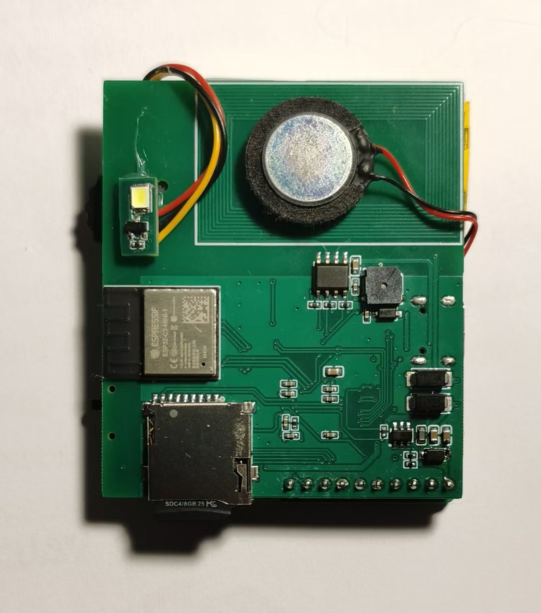
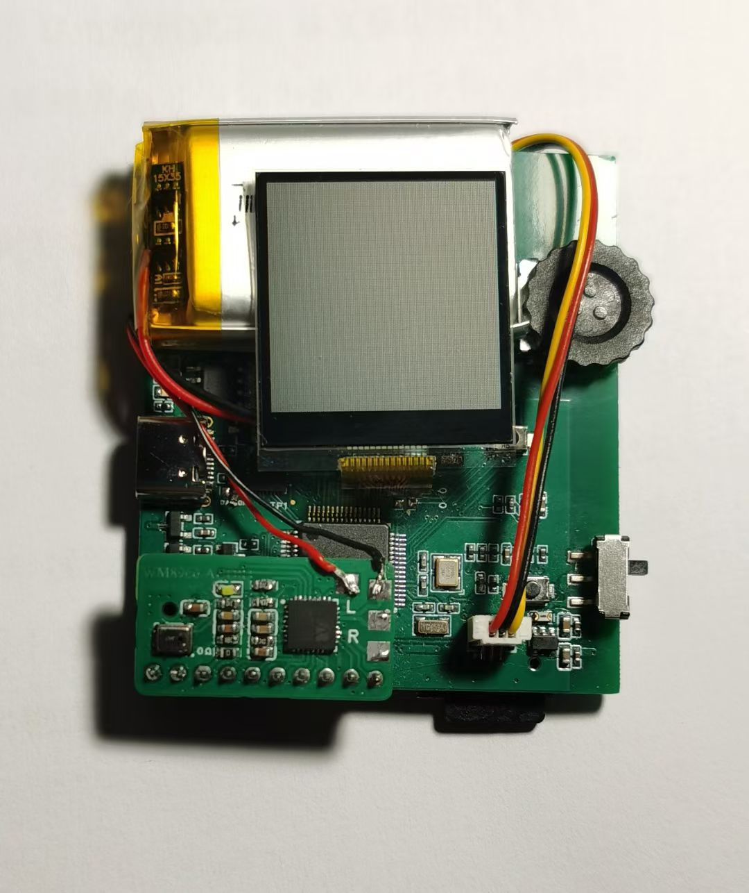
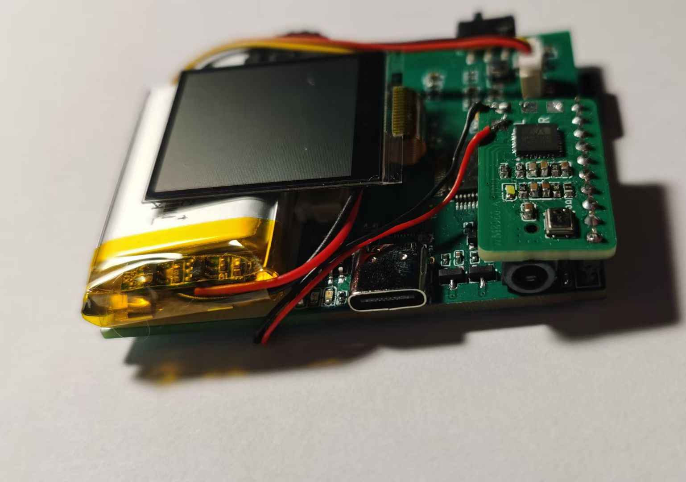
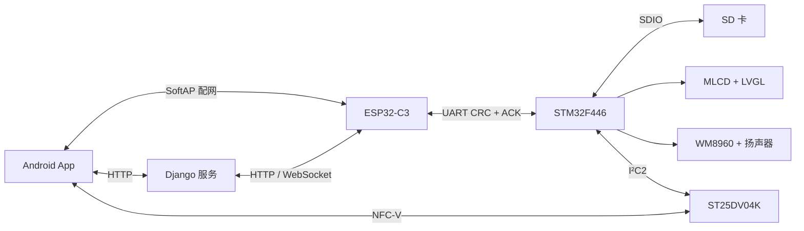

# Acho

联网多媒体终端：STM32F446负责本地交互、媒体与NFC，ESP32-C3负责配网和网络桥，Android与Django提供账号、设备和媒体服务。

## 系统架构

STM32不直接访问服务器，网络请求均由ESP32执行；手机不直接写入SD卡，终端通过协议接收并校验文件后安装到SD卡。

## 子工程

| 目录 | 作用 |
| --- | --- |
| `acho/Firmware/stm32f446` | STM32固件：FreeRTOS、LVGL、SDIO、音频、NFC与外设控制 |
| `acho/Firmware/esp32c3` | ESP32固件：SoftAP配网、NVS、HTTP/WebSocket与UART桥接 |
| `acho/Firmware/common` | 两端共用的帧格式、Wi-Fi状态和NDEF编码 |
| `acho/Hardware` | 主板/音频板原理图、BOM、Gerber、手册和结构资料 |
| `iot_app` | Android客户端：登录、配网、绑定、媒体管理 |
| `iot_server` | Django服务：账号、设备绑定、媒体存储与设备文件接口 |
| `image_encoder` | LVGL BIN素材转换工具的发布包 |
| `model` | 关键词模型、训练和导出脚本 |
| `assets` | 项目实物照片与 README 展示资源 |

## 主要功能

- SD卡中的动画、图片和16-bit PCM WAV播放。
- Wi-Fi SoftAP配网、二维码/NFC绑定、设备媒体下载。
- ST25DV04K NDEF发布与WM8960音频输出。
- 闪光灯、蜂鸣器、编码器菜单和ESP32下载模式。

## 快速入口

| 目标 | 入口 |
| --- | --- |
| STM32固件 | `acho/Firmware/stm32f446/Firmware.ioc`、`CMakeLists.txt` |
| ESP32固件 | `acho/Firmware/esp32c3/CMakeLists.txt`、`main/esp32c3.c` |
| Android应用 | `iot_app/settings.gradle`、`iot_app/app/` |
| Django服务 | `iot_server/djangoProject/manage.py` |
| 硬件资料 | `acho/Hardware/PCBs/`、`acho/Hardware/Datasheets/` |
| 毕业设计论文 | [`paper.pdf`](paper.pdf) |

## 毕业设计论文

[`paper.pdf`](paper.pdf) 归档 Acho 毕业设计的整体方案、软硬件实现和验证内容，用于理解系统设计背景与模块分工。论文不参与 STM32、ESP-IDF、Android 或 Django 的构建；当前接口与行为以各子工程的 `README.md` 和源代码为准。

各子工程的关键文件、协议边界和构建方式见对应目录的`README.md`。
